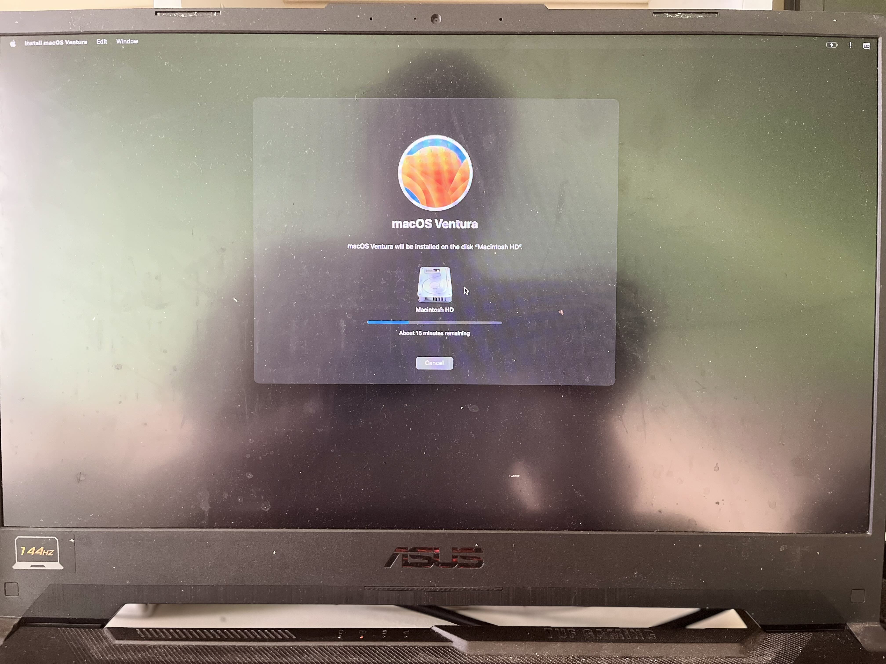
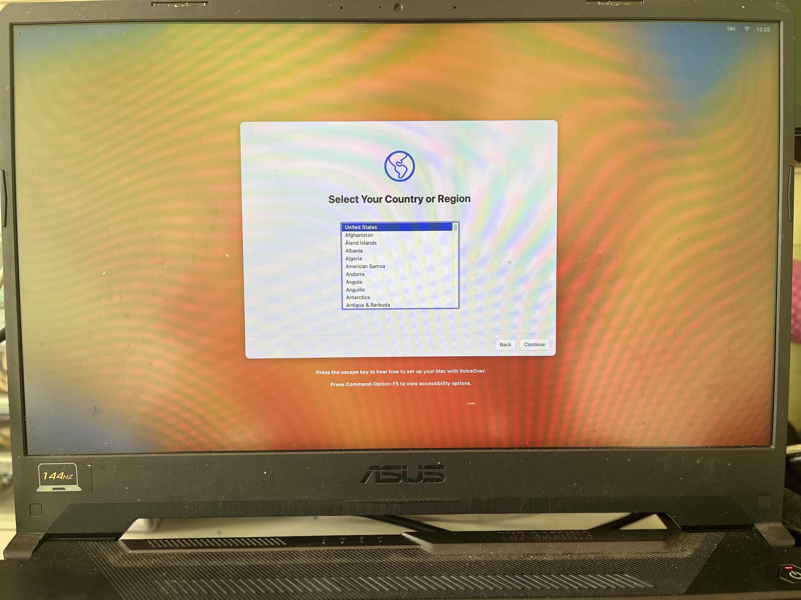
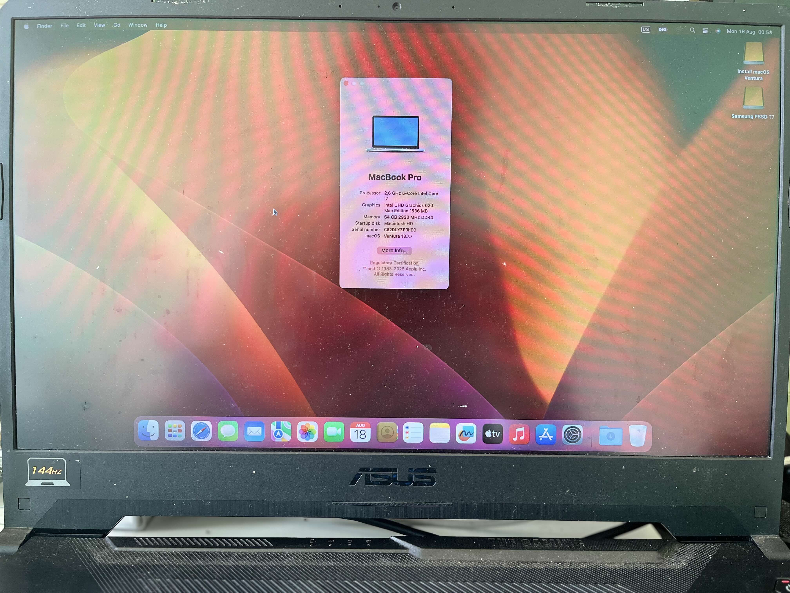

# ASUS TUF Gaming F15 FX506LH — OpenCore EFI

OpenCore EFI, BIOS settings and install notes for running **macOS 26 Tahoe** on the
**ASUS TUF Gaming F15 FX506LH** (Intel Comet Lake). Shared for owners of the same model.

> ⚠️ This EFI is built for the exact hardware below. On a different model or configuration, use it as a
> reference only, and build your own following the [Dortania guide](https://dortania.github.io/OpenCore-Install-Guide/).

---

## 🔧 Hardware

| Component | Model | macOS support |
|---|---|---|
| CPU | Intel Core i7-10750H (Comet Lake-H, 6C/12T) | ✅ Native (XCPM) |
| iGPU | Intel UHD Graphics 630 | ✅ WhateverGreen |
| dGPU | NVIDIA GeForce GTX 1650 (Turing) | ❌ No driver, disabled |
| Memory | 64 GB DDR4-3200 | ✅ |
| Storage | Micron 2210 512 GB NVMe (MTFDHBA512QFD) | ✅ NVMeFix |
| Storage | Kingston 512 GB NVMe (OM8PCP3512F-AB) | ✅ NVMeFix |
| Ethernet | Realtek RTL8111/8168 | ✅ RealtekRTL8111 |
| Wi-Fi / Bluetooth | Intel Wi-Fi 6 AX201 | ✅ Wi-Fi (itlwm + HeliPort) · ❌ Bluetooth not configured |
| Audio | Realtek ALC256 | ✅ AppleALC, `layout-id` 33 (Tahoe: + OCLP-Mod root patch) |
| Trackpad | I2C HID | ✅ VoodooI2C |
| Keyboard | PS/2 | ✅ VoodooPS2, brightness keys via BrightnessKeys |

---

## ✅ Status

| | |
|---|---|
| macOS | 26 Tahoe |
| OpenCore | **1.0.5** (RELEASE) |
| SMBIOS | `MacBookPro16,1` |
| SIP / SecureBootModel | `0x803` / `Disabled` (required for the audio root patch) |
| Latest release | [v2.0.2](https://github.com/4thmyber/ASUS-TUF-GAMING-F15-FX506LH/releases/tag/v2.0.2) |
| Working | Graphics acceleration & brightness, audio, Wi-Fi, Ethernet, trackpad, keyboard & brightness keys, battery status, NVMe |
| Not working | NVIDIA dGPU (unsupported by macOS), Bluetooth (not configured) |
| Not yet verified | Sleep/wake, all USB ports (no USB map yet — see [roadmap](./docs/roadmap.md)) |

---

## 📦 EFI contents

**OpenCore 1.0.5** — `OpenCore.efi`, `BOOTx64.efi`, `OpenRuntime.efi` from the official
[OpenCorePkg](https://github.com/acidanthera/OpenCorePkg/releases/tag/1.0.5) release; `OpenHfsPlus.efi` from
[OcBinaryData](https://github.com/acidanthera/OcBinaryData).

### Kexts

| Kext | Version | Purpose | Source |
|---|---|---|---|
| Lilu | 1.7.1 | Patching framework (required by the plugins below) | [acidanthera/Lilu](https://github.com/acidanthera/Lilu) |
| VirtualSMC | 1.3.7 | SMC emulation | [acidanthera/VirtualSMC](https://github.com/acidanthera/VirtualSMC) |
| SMCBatteryManager | 1.3.7 | Battery status | [acidanthera/VirtualSMC](https://github.com/acidanthera/VirtualSMC) |
| WhateverGreen | 1.7.0 | iGPU, backlight, disables dGPU (`-wegnoegpu`) | [acidanthera/WhateverGreen](https://github.com/acidanthera/WhateverGreen) |
| AppleALC | 1.9.5 | Audio (ALC256) | [acidanthera/AppleALC](https://github.com/acidanthera/AppleALC) |
| NVMeFix | 1.1.3 | NVMe power management | [acidanthera/NVMeFix](https://github.com/acidanthera/NVMeFix) |
| BrightnessKeys | 1.0.3 | Fn brightness keys | [acidanthera/BrightnessKeys](https://github.com/acidanthera/BrightnessKeys) |
| VoodooPS2Controller | 2.3.7 | Keyboard (+ Keyboard, Mouse, Trackpad plugins 2.3.7) | [acidanthera/VoodooPS2](https://github.com/acidanthera/VoodooPS2) |
| VoodooI2C | 2.9.1 | I2C trackpad (+ VoodooGPIO 1.1, VoodooI2CServices 1.0, VoodooInput 1.1.6) | [VoodooI2C/VoodooI2C](https://github.com/VoodooI2C/VoodooI2C) |
| VoodooI2CHID | 1.0 (from VoodooI2C 2.9.1) | I2C HID satellite | [VoodooI2C/VoodooI2C](https://github.com/VoodooI2C/VoodooI2C) |
| itlwm | 2.3.0 | Intel Wi-Fi (use with [HeliPort](https://github.com/OpenIntelWireless/HeliPort)) | [OpenIntelWireless/itlwm](https://github.com/OpenIntelWireless/itlwm) |
| RealtekRTL8111 | 2.5.0 | Ethernet | [Mieze/RTL8111_driver_for_OS_X](https://github.com/Mieze/RTL8111_driver_for_OS_X) |
| AMFIPass | 1.4.1 | Lets the root-patched AppleHDA load with AMFI enabled; macOS 26 only | [dortania/OpenCore-Legacy-Patcher](https://github.com/dortania/OpenCore-Legacy-Patcher) |

### ACPI

| SSDT | Purpose |
|---|---|
| SSDT-PLUG | CPU power management (XCPM) |
| SSDT-EC-USBX | Fake EC device + USB power properties |
| SSDT-AWAC-DISABLE | Use legacy RTC instead of AWAC |
| SSDT-PMC | Native NVRAM on 300-series+ chipsets |
| SSDT-PNLF | Backlight control |
| SSDT-XOSI | Windows `_OSI` emulation (with `_OSI → XOSI` rename) for I2C trackpad |

---

## 🚀 Usage

1. Configure the BIOS with the [BIOS guide](./docs/bios-guide.md).
2. **Generate your own SMBIOS** (`MacBookPro16,1`) with [GenSMBIOS](https://github.com/corpnewt/GenSMBIOS) and put
   the serial, MLB, SystemUUID and ROM into `EFI/OC/Config.plist` → `PlatformInfo/Generic`. Do not reuse the values in this repo.
3. Download `EFI-<version>.zip` from [Releases](https://github.com/4thmyber/ASUS-TUF-GAMING-F15-FX506LH/releases)
   (tested versions; `main` may contain untested changes), copy `EFI/` to a FAT32 USB stick, boot it with **F8**, install macOS.
4. After a successful boot, copy `EFI/` to the internal EFI partition — see the [runbook](./docs/runbook.md).
5. Wi-Fi: install [HeliPort](https://github.com/OpenIntelWireless/HeliPort/releases).
   Audio on Tahoe: run the [OCLP-Mod](https://github.com/laobamac/OCLP-Mod/releases) **Post-Install Root Patch**
   (steps in the [v2.0.2 release notes](https://github.com/4thmyber/ASUS-TUF-GAMING-F15-FX506LH/releases/tag/v2.0.2)); repeat after each macOS update.

Validate changes before booting: `./scripts/check.sh` (runs `ocvalidate` for the pinned OpenCore version and EFI
consistency checks; also runs in CI).

---

## 🖥️ BIOS Configuration

**Full guide with screenshots, BIOS update steps and troubleshooting: [docs/bios-guide.md](./docs/bios-guide.md)**
(tested on BIOS 310; recommendations are updated there).

Summary — **Disabled:** Fast Boot, Secure Boot, VT-d, Network Stack ·
**Enabled:** Internal Pointing Device, Hyper-Threading, VT-x, USB Mass Storage Driver Support ·
**DVMT Pre-Allocated:** 64M · **SATA:** AHCI (no RST/VMD) · **I/O Interface Security:** all Unlock.

---

## ⚙️ Installation

---

## 📌 Notes

- BIOS settings: [docs/bios-guide.md](./docs/bios-guide.md) · Changes per version: [CHANGELOG.md](./CHANGELOG.md) · Troubleshooting & recovery: [docs/runbook.md](./docs/runbook.md) ·
  Planned improvements & references: [docs/roadmap.md](./docs/roadmap.md)
- Issues and tips from owners of the same model are welcome — use the bug report template and redact serial numbers.
  Contributions: see [CONTRIBUTING.md](./CONTRIBUTING.md).

## 📄 License

MIT for the configuration, scripts and documentation. OpenCore, drivers and kexts keep their own licenses — see [LICENSE](./LICENSE).

## 🙏 Credits

[Acidanthera](https://github.com/acidanthera) (OpenCore, Lilu & plugins), [Dortania](https://dortania.github.io/),
[VoodooI2C](https://github.com/VoodooI2C), [OpenIntelWireless](https://github.com/OpenIntelWireless),
[Mieze](https://github.com/Mieze), [CorpNewt](https://github.com/corpnewt).
